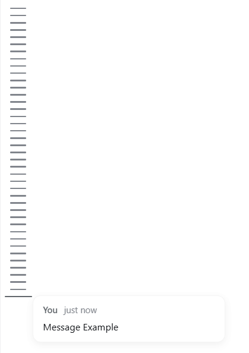

# MsgRail（dsh-msgrail）

> **MsgRail** is a narrow message rail for [DeepSeek Harness](https://github.com/deepseek-ai/deepseek-harness): one thin bar on the left of the chat for each message you sent. Hover to preview, click to jump — older messages load automatically. Full history, live, bilingual.
>
> **MsgRail（消息轨道）**——DeepSeek Harness 的窄消息轨道插件：在对话左侧，为每条你发送的消息显示一根细横线。悬停看预览、点击即跳转，更早消息自动加载；全量历史、实时更新、中英双语。

> 中文说明见 [README.zh.md](README.zh.md)

**Repository / 仓库**:

- GitHub: <https://github.com/chou109/dsh-msgrail.git>
- Gitee (mainland-China mirror — faster there): <https://gitee.com/chill109/dsh-msgrail.git>

---

## Screenshots

> Demo captures from `dsh web` (light theme), stored in `docs/screenshots/`.

| The message rail | Message example |
|---|---|
|  |  |

---

# If you are a human, read this

## What it does

- A **very narrow rail (44px) on the left of the chat** — between the sidebar and the
  messages, no divider; the rail background joins the conversation area.
- One **thin horizontal bar per message YOU sent** in the current conversation (AI replies,
  auto-injected context, interrupts and commands are all excluded), densely stacked and
  **vertically centered** in the rail. No text in the rail — a pure minimap of your prompts.
- **The whole history is indexed** — the rail fetches the complete conversation history
  itself, so older messages appear even before they are loaded into the chat window.
- **Hover a bar** → it grows **longer and bolder**, and an attached **preview card** shows
  your exact message text + time, auto-positioned inside the viewport (auto-injected hint
  blocks, such as the paste-image instructions, are hidden). **Click a bar** → the
  conversation scrolls to that message; older messages are loaded automatically first if
  they are not yet in the chat window.
- **Scrolls when overflowing** — scroll up for older messages; the view stays pinned to the
  latest as new messages arrive. **Switching sessions** reloads the rail for the new chat.
- Deliberately minimal: no collapse, no search, no session list, no separate workspace.

## Manual deployment

Requires: DeepSeek Harness web profile (`dsh web`), rc.6 line. No build toolchain needed.

1. **Patch the host layout** (one-time; re-run after every harness update):

   ```bash
   node scripts/patch-layout.mjs
   ```

   The script adds a `shell.history` grid column to `@deepseek-ai/dsh-client-ui-layout`
   (sized by `var(--dsh-history-width)`, default `0px`, so an uninstalled plugin costs no
   space). It is idempotent and reports loudly if an anchor no longer matches. The layout
   bundle is resolved from `$DSH_HOME` (falling back to `~/.dsh`); pass the path explicitly
   (`node scripts/patch-layout.mjs <path>`) for non-standard layouts.

2. **Copy the plugin into the profile's node_modules**:

   ```bash
   cp -r dsh-msgrail ~/.dsh/profiles/node_modules/
   # or on Windows PowerShell:
   Copy-Item -Recurse dsh-msgrail "$env:USERPROFILE\.dsh\profiles\node_modules\"
   ```

3. **Register the plugin** in `~/.dsh/profiles/web/cordis.patch.yml` (append):

   ```yaml
   - insert:
       - id: msgrail
         name: 'dsh-msgrail'
   ```

4. **Restart the harness** (`dsh web`). The rail appears on the left of the chat.

## How to let an AI deploy it

Tell your AI agent:

> Please deploy the MsgRail plugin from https://github.com/chou109/dsh-msgrail.git
> (or the Gitee mirror, faster in mainland China: https://gitee.com/chill109/dsh-msgrail.git)
> to my DeepSeek Harness web profile. Follow the "If you are an AI, read this" section of the
> README exactly.

The AI section below contains the full deployment, verification and debugging instructions.

## Uninstall

1. Remove the `msgrail` entry from `~/.dsh/profiles/web/cordis.patch.yml`.
2. Delete `~/.dsh/profiles/node_modules/dsh-msgrail/`.
3. (Optional) revert the layout patch by re-installing/upgrading
   `@deepseek-ai/dsh-client-ui-layout` (the column disappears automatically once the
   plugin's stylesheet is gone, so this is optional).
4. Restart `dsh web`.

---

# If you are an AI, read this

## Mission

Deploy the `dsh-msgrail` plugin for a DeepSeek Harness **web** profile (`dsh web`,
rc.6 line). The deliverable is a `shell.history` grid column in the host layout plus a
client bundle that renders a **narrow message rail** — one bar per user-sent message of the
current conversation, with hover previews and click-to-jump.

## Repository layout

```
dsh-msgrail/
├── package.json              # plugin manifest: dsh.client declaration + exports["./client"]
├── lib/
│   ├── index.js              # minimal cordis host half (keeps the Loader entry valid)
│   └── client.js             # the browser bundle (hand-written, follows the client-bundle contract)
├── scripts/
│   └── patch-layout.mjs      # idempotent patch for @deepseek-ai/dsh-client-ui-layout
├── README.md / README.zh.md
└── LICENSE (MIT)
```

## How the pieces fit

- **Client discovery**: the harness's client-modules scans enabled Loader entries for
  packages declaring `dsh.client`, resolves `exports["./client"]`, hashes the bundle, serves
  it at `/plugins/<id>/client.js` and injects it into the browser boot graph. The bundle
  registers via `window.__ModuleLoader__.load({ id, factory })`; the factory receives the
  shell's `require` (react, react/jsx-runtime, @deepseek-ai/dsh-client-ui-primitives).
- **Layout column**: `scripts/patch-layout.mjs` edits
  `@deepseek-ai/dsh-client-ui-layout/lib/client.js` (three edits): the grid becomes
  `sidebar | var(--dsh-history-width, 0px) | center | details`; a
  `<div class="dsh-layout-historyCol">` renders the `shell.history` slot between the sidebar
  and the conversation; `"shell.history": { kind: "single", scope: "root" }` is declared.
  The idempotency marker is `dsh-session-history (patched)` (predates the rename — do NOT
  change it; the already-patched host layout carries it).
- **Rail width**: the bundle's stylesheet declares `:root { --dsh-history-width: 44px }`
  (removed automatically on unload via the loader's style-tag tracking). The hovered bar's
  preview is a `position: fixed` card measured at runtime and clamped inside the viewport
  (flip left on right-edge overflow, shift up on bottom overflow).
- **Message data — full history, your messages only**: the rail pages through
  `session.history({ beforeSeq, maxMessages: 200 })` (via `ctx.sessions.binding(id)?.session`)
  until `hasMore` is false, and renders one bar per `user/message` event whose
  `surfaceOp === "append"` **and** `data.source.kind === "user"` (assistant replies,
  steering, context injections and commands are skipped — the conversation UI's own
  discriminators), ordered by `event.seq`. Live updates come from `session.subscribe` → a
  debounced (250ms) tail refetch merged by `seq`.
- **Preview text**: extracted from the content blocks' `text` field; blocks that are
  auto-injected hints (starting with `[图片附件`, `[系统提示：当前模型无法直接查看图片` or
  `[用户粘贴的图片`) are skipped.
- **Jump**: the conversation anchors rows with
  `data-chat-anchor-key={conversationContextKey(definitionKind, id)}` — the user definition
  is `input-message` (id = message id), so the key is `{13}:input-message{id}`. If the
  anchor is absent (message not yet loaded), the rail calls `session.loadOlder()` repeatedly
  (cap 60 pages) until the anchor appears, then `scrollIntoView({behavior:"smooth", block:"center"})`.

## Deployment steps (exact)

1. **Patch the layout** (from the repo root):

   ```bash
   node scripts/patch-layout.mjs
   # the default target is resolved from $DSH_HOME (~/.dsh); or pass an explicit path:
   node scripts/patch-layout.mjs "<path>/node_modules/@deepseek-ai/dsh-client-ui-layout/lib/client.js"
   ```

2. **Install the package**:

   ```bash
   echo ${DSH_HOME:-$HOME/.dsh}   # e.g. C:\Users\<you>\.dsh on Windows
   cp -r dsh-msgrail "$DSH_HOME/profiles/node_modules/"   # the package folder itself
   ```

3. **Register the Loader entry** in `"$DSH_HOME/profiles/web/cordis.patch.yml"`:

   ```yaml
   - insert:
       - id: msgrail
         name: 'dsh-msgrail'
   ```

4. **Restart** `dsh web`.

## Verification

- `node --check` passes on `lib/client.js`, `lib/index.js`, `scripts/patch-layout.mjs`.
- Installed copy: `node -e "console.log(require('<installed>/package.json').exports['./client'])"`
  prints `./lib/client.js`.
- **JSON/BOM trap**: `package.json` must be **UTF-8 without BOM** (the harness parses it
  with `JSON.parse`; a BOM aborts startup with `Unexpected token ''`). Check:
  `grep -rl $'\xef\xbb\xbf' "$DSH_HOME" --exclude-dir=node_modules`; strip:
  `sed -i '1s/^\xEF\xBB\xBF//' package.json`.
- After restart: the rail appears left of the chat; hovering shows a preview (clamped to the
  viewport), clicking jumps (auto-loading older pages when needed), and switching sessions
  reloads the rail.

## Debugging

- **Column missing**: restart needed? `msgrail` in `cordis.patch.yml`? installed
  `package.json` declares `dsh.client` + `exports["./client"]`? layout patch marker present?
  browser console errors on `/plugins/dsh-msgrail/client.js`?
- **Startup crash `Unexpected token ''`**: BOM in `package.json` (strip it).
- **Bars ≠ your messages**: the filters are `surfaceOp === "append"` and
  `data.source.kind === "user"`; injected/assistant/steer rows are skipped by design.
- **Jump does nothing**: the target may be outside the loaded window; the rail calls
  `loadOlder()` (max 60 pages); if the session has no more history the anchor cannot exist.
- **Harness upgrade drift**: slot names (`shell.history`), `ctx.sessions.binding`, the
  history RPC and the chat-node key formula are internal APIs — re-run
  `scripts/patch-layout.mjs` and re-check after upgrades.

## Operations

- **Version bump**: edit `version` in `package.json`, re-copy the package folder to the
  profile's node_modules (both copies byte-identical, BOM-free). Never rewrite JSON via
  PowerShell `Set-Content -Encoding UTF8` (writes a BOM on Windows PowerShell).
- **Harness update**: re-run `scripts/patch-layout.mjs`, restart.

---

## Compatibility and limitations

- Targeted at the rc.6 web profile; slot names, the session service API and layout internals
  are private and may change in later versions.
- Requires the host-layout patch (idempotent re-apply script included).
- Fixed 44px rail (no collapse, no resizing); only the current conversation's user-sent
  messages are shown.

## License

[MIT](LICENSE)
