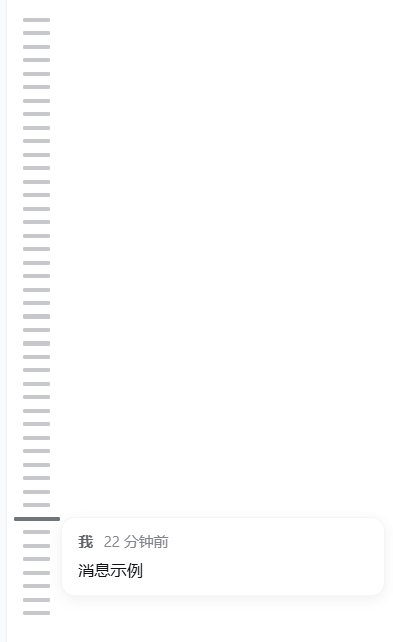

# MsgRail（dsh-msgrail）

> **MsgRail（消息轨道）**——[DeepSeek Harness](https://github.com/deepseek-ai/deepseek-harness) 的窄消息轨道插件：在对话左侧，为每条你发送的消息显示一根细横线。悬停看预览、点击即跳转，更早消息自动加载；全量历史、实时更新、中英双语。
>
> **MsgRail** is a narrow message rail for DeepSeek Harness: one thin bar on the left of the chat for each message you sent. Hover to preview, click to jump — older messages load automatically. Full history, live, bilingual.

> English version: [README.md](README.md)

**仓库 / Repository**: <https://github.com/chou109/dsh-msgrail.git>

---

## 展示图

> `dsh web`（亮色主题）实拍演示图，存放在 `docs/screenshots/`。

| 消息轨道 | 悬停预览（自适应） |
|---|---|
|  |  |

---

# 如果你是人类请看

## 这个插件是干什么的

- 在**对话区左侧**多出一条**极窄（44px）的横线轨道**——位于侧边栏与消息区之间，无分割线，
  背景与消息区直接相接。
- 当前会话中**每条"你发送的消息"对应一根细横线**（AI 回复、自动注入的上下文、干预、命令类
  一律不计入），竖向密集排列并在轨道内**垂直居中**。轨道内没有文字，是你所发消息的纯视觉缩略图。
- **全量历史**：轨道自己拉取完整会话历史，更早的消息即使还没载入对话窗口也会以横线出现。
- **悬停某根横线** → 变长变粗，旁边弹出**预览卡片**（你的原文 + 时间，自动避开屏幕边缘；
  其他插件注入的提示块如粘贴图片的"系统提示"会被隐藏）。**点击横线** → 会话区滚动到这条消息，
  若该消息尚未载入会自动先加载更早消息再跳转。
- **超出高度可滚动**：往上滚查看更早对话，新消息到来时视图停在最新位置；**切换会话**时轨道
  自动重载为新会话的消息。
- 刻意极简：不做折叠、不做搜索、不做会话列表、不开独立工作区。

## 手动部署

要求：DeepSeek Harness web profile（`dsh web`），rc.6 版本线；无需构建工具链。

1. **给主布局打补丁**（一次性；harness 升级后需重跑）：

   ```bash
   node scripts/patch-layout.mjs
   ```

   脚本为 `@deepseek-ai/dsh-client-ui-layout` 增加 `shell.history` 网格列（宽度由
   `var(--dsh-history-width)` 控制，默认 `0px`，插件未安装时不占空间）；幂等，锚点不匹配会
   明确报错。

2. **把插件复制进 profile 的 node_modules**：

   ```bash
   cp -r dsh-msgrail ~/.dsh/profiles/node_modules/
   # Windows PowerShell：
   Copy-Item -Recurse dsh-msgrail "$env:USERPROFILE\.dsh\profiles\node_modules\"
   ```

3. **注册插件**：在 `~/.dsh/profiles/web/cordis.patch.yml` 末尾追加：

   ```yaml
   - insert:
       - id: msgrail
         name: 'dsh-msgrail'
   ```

4. **重启 harness**（`dsh web`），轨道即出现在对话左侧。

## 怎么让 AI 帮你部署

直接对你的 AI 助手说：

> 请把 https://github.com/chou109/dsh-msgrail.git 仓库里的 MsgRail 插件部署到我的
> DeepSeek Harness web profile。严格按照 README 中"如果你是 AI 请看"这一节执行。

下面"如果你是 AI 请看"一节包含完整的部署、验证与调试说明。

## 卸载

1. 从 `~/.dsh/profiles/web/cordis.patch.yml` 删除 `msgrail` 条目。
2. 删除 `~/.dsh/profiles/node_modules/dsh-msgrail/` 目录。
3. （可选）重装/升级 `@deepseek-ai/dsh-client-ui-layout` 还原布局补丁（插件样式表消失后列会
   自动消失，此步可跳过）。
4. 重启 `dsh web`。

---

# 如果你是 AI 请看

## 任务目标

为 DeepSeek Harness **web** profile（`dsh web`，rc.6 版本线）部署 `dsh-msgrail` 插件。
交付物：主布局中多出一列 `shell.history` 网格列；一个在该列渲染**窄消息轨道**（当前会话中
每条用户发送的消息一根横线，悬停预览、点击跳转）的客户端 bundle。

## 仓库结构

```
dsh-msgrail/
├── package.json              # 插件清单：dsh.client 声明 + exports["./client"]
├── lib/
│   ├── index.js              # 最小化的 cordis host 半区（保证 Loader 条目合法）
│   └── client.js             # 浏览器 bundle（手写，遵循客户端 bundle 契约）
├── scripts/
│   └── patch-layout.mjs      # 对 @deepseek-ai/dsh-client-ui-layout 的幂等补丁
├── README.md / README.zh.md
└── LICENSE (MIT)
```

## 工作原理

- **客户端发现**：harness 的 client-modules 扫描声明了 `dsh.client` 的 Loader 条目，解析
  `exports["./client"]`、哈希后托管到 `/plugins/<id>/client.js` 并注入浏览器启动图。bundle
  用 `window.__ModuleLoader__.load({ id, factory })` 注册；factory 拿到 shell 的 `require`
  （react、react/jsx-runtime、@deepseek-ai/dsh-client-ui-primitives）。
- **布局列**：`scripts/patch-layout.mjs` 修改 `@deepseek-ai/dsh-client-ui-layout/lib/client.js`
  （三处）：网格变为 `sidebar | var(--dsh-history-width, 0px) | center | details`；插入
  `<div class="dsh-layout-historyCol">` 渲染 `shell.history` 槽位；声明
  `"shell.history": { kind: "single", scope: "root" }`。幂等标记是
  `dsh-session-history (patched)`（早于本次改名，**不要改动**——已打补丁的宿主布局里就是它）。
- **轨道宽度**：bundle 样式表声明 `:root { --dsh-history-width: 44px }`（卸载时由 loader 的
  样式标签回收自动移除）。悬停预览是 `position: fixed` 卡片，运行时实测尺寸并钳制在视口内
  （右缘溢出翻到左侧、底部溢出上移）。
- **消息数据——全量历史、只含你自己的消息**：通过 `ctx.sessions.binding(id)?.session` 分页
  拉取 `session.history({ beforeSeq, maxMessages: 200 })` 直到 `hasMore` 为 false，只为
  **`surfaceOp === "append"` 且 `data.source.kind === "user"`** 的 `user/message` 事件生成
  横线（AI 回复、干预、上下文注入、命令类跳过——与会话 UI 的判别条件一致），按 `event.seq`
  排序。实时更新来自 `session.subscribe` → 250ms 防抖**尾部重取**并按 `seq` 合并。
- **预览文本**：取内容块的 `text` 字段；以 `[图片附件`、`[系统提示：当前模型无法直接查看图片`、
  `[用户粘贴的图片` 开头的自动注入提示块会被跳过。
- **跳转**：会话用 `data-chat-anchor-key={conversationContextKey(definitionKind, id)}` 锚定
  消息行——用户定义是 `input-message`（id = 消息 id），即 key 为 `13:input-message{id}`。
  若锚点不存在（消息未载入），轨道会反复调用 `session.loadOlder()`（上限 60 页）直到锚点出现，
  再 `scrollIntoView({behavior:"smooth", block:"center"})`。

## 部署步骤（精确）

1. **打布局补丁**（在仓库根目录）：

   ```bash
   node scripts/patch-layout.mjs
   # 或显式传路径：
   node scripts/patch-layout.mjs "<路径>/node_modules/@deepseek-ai/dsh-client-ui-layout/lib/client.js"
   ```

2. **安装插件包**：

   ```bash
   echo ${DSH_HOME:-$HOME/.dsh}   # Windows 例如 C:\Users\<你>\.dsh
   cp -r dsh-msgrail "$DSH_HOME/profiles/node_modules/"   # 注意是包目录本身
   ```

3. **注册 Loader 条目**：向 `"$DSH_HOME/profiles/web/cordis.patch.yml"` 追加：

   ```yaml
   - insert:
       - id: msgrail
         name: 'dsh-msgrail'
   ```

4. **重启** `dsh web`。

## 验证

- `node --check` 对 `lib/client.js`、`lib/index.js`、`scripts/patch-layout.mjs` 全部通过。
- 安装副本：`node -e "console.log(require('<安装路径>/package.json').exports['./client'])"`
  输出 `./lib/client.js`。
- **JSON/BOM 陷阱**：`package.json` 必须是 **UTF-8 无 BOM**（harness 用 `JSON.parse` 解析，
  带 BOM 启动即崩，报 `Unexpected token ''`）。排查：`grep -rl $'\xef\xbb\xbf' "$DSH_HOME"
  --exclude-dir=node_modules`；去除：`sed -i '1s/^\xEF\xBB\xBF//' package.json`。
- 重启后：对话左侧出现轨道；悬停出预览（视口内自适应）、点击跳转（必要时自动加载更早页）、
  切换会话自动重载。

## 调试

- **列没出现**：是否重启？`cordis.patch.yml` 是否有 `msgrail`？安装副本的 `package.json`
  是否声明 `dsh.client` + `exports["./client"]`？布局补丁标记是否存在？浏览器控制台是否报
  `/plugins/dsh-msgrail/client.js` 加载错误？
- **启动报 `Unexpected token ''`**：`package.json` 带 BOM——去除（见上）。
- **横线≠你的消息**：过滤条件是 `surfaceOp === "append"` 与 `data.source.kind === "user"`；
  注入/AI/干预类按设计跳过。
- **跳转无效**：目标可能在已加载窗口之外；轨道会调用 `loadOlder()`（上限 60 页）；若会话
  已无更早历史则锚点不存在。
- **harness 升级漂移**：槽位名（`shell.history`）、`ctx.sessions.binding`、history RPC 与
  聊天节点 key 公式均为内部 API——升级后重跑 `scripts/patch-layout.mjs` 并重新核对。

## 运维

- **升版本**：修改 `package.json` 的 `version`，重新把包目录复制到 profile 的 node_modules
  （两份副本字节一致、无 BOM）。**不要用 Windows PowerShell 的 `Set-Content -Encoding UTF8`
  重写 JSON**（会写入 BOM）。
- **harness 升级后**：重跑 `scripts/patch-layout.mjs`，重启。

---

## 兼容性与限制

- 面向 rc.6 web profile；槽位名、会话服务 API 与布局内部实现均属私有，后续版本可能变化。
- 需要主布局补丁（自带幂等重打脚本）。
- 轨道固定 44px 宽（不支持折叠/调宽）；只显示当前会话中你发送的消息。

## 许可证

[MIT](LICENSE)
